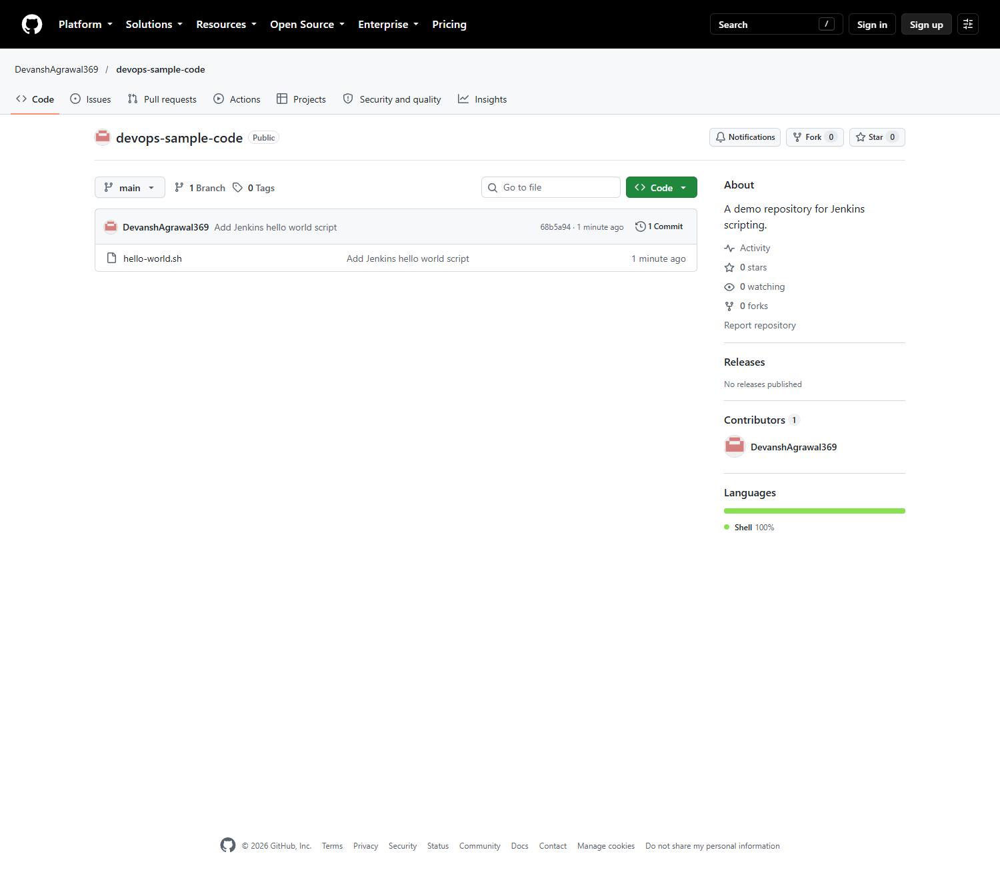
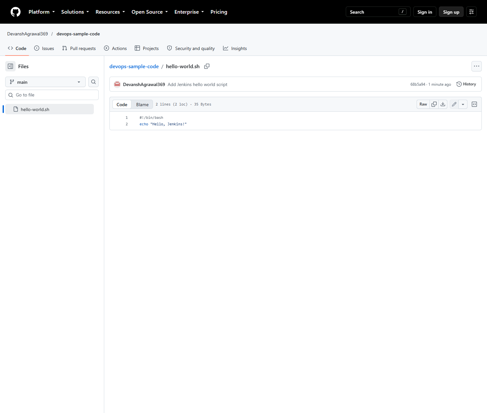
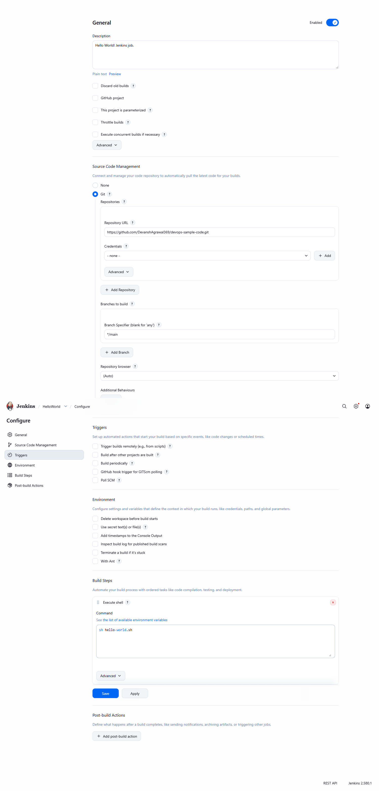
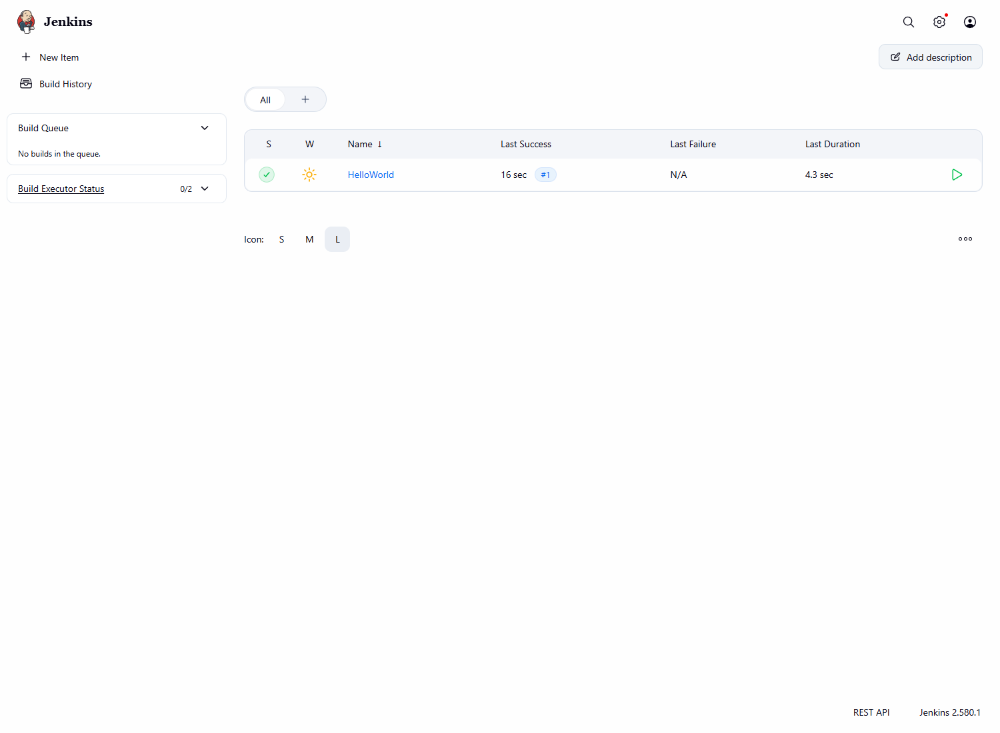
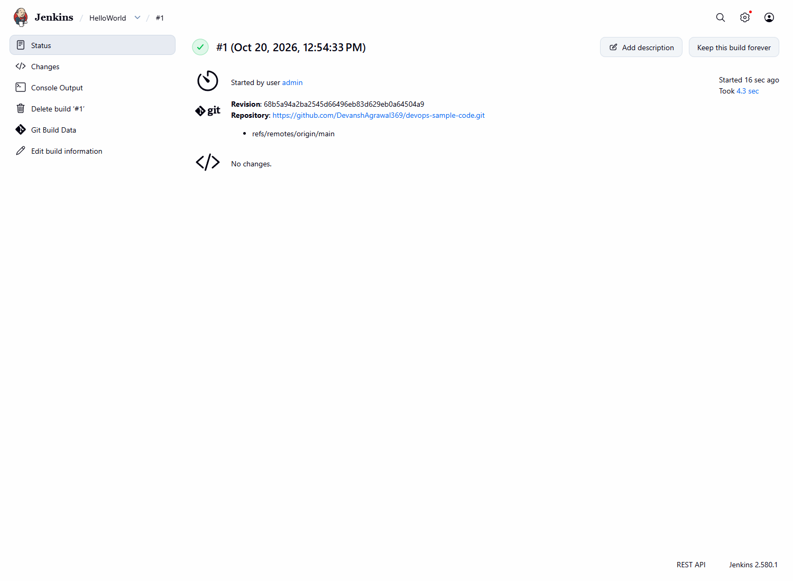
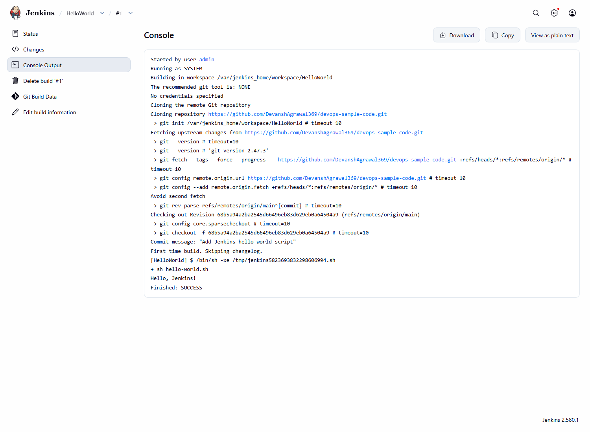

# Exercise 8 — Creating a Hello World Jenkins Job

## Objective

Publish a tiny Bash script to a separate public GitHub repository, configure a Jenkins Freestyle project to check out that repository, execute the script on Jenkins' Linux controller agent, and verify the real build output.

## Prerequisites

- Git and GitHub CLI (`gh`) authenticated to the account that owns the public sample repository.
- Docker Desktop and the existing Jenkins instance, with its persistent home volume preserved.
- Jenkins Git plugin, Linux `sh`, and `git` available on the build node.
- Browser access to `http://localhost:8081` and an authorized Jenkins account.

The Jenkins Git plugin and `/usr/bin/sh` and `/usr/bin/git` were verified in the running Jenkins container. The existing Jenkins instance maps host loopback port 8081 to container port 8080 and stores its data in `devops-exercise7-jenkins-home`. The Minikube forward on host port 8080 was left untouched.

## GitHub repository and script

The separate repository is public: [DevanshAgrawal369/devops-sample-code](https://github.com/DevanshAgrawal369/devops-sample-code). It contains `hello-world.sh` on `main`:

```bash
#!/bin/bash
echo "Hello, Jenkins!"
```

The sample was created in a separate local Git checkout, committed as `68b5a94` (`Add Jenkins hello world script`), and pushed to `main`. Its remote is `https://github.com/DevanshAgrawal369/devops-sample-code.git`; the main DevOps repository's remote was not changed.

## Jenkins Freestyle job

The real job is named **HelloWorld** with description **Hello World! Jenkins job.** It has these settings:

- Source Code Management: **Git**
- Repository URL: `https://github.com/DevanshAgrawal369/devops-sample-code.git`
- Branch specifier: `*/main`
- Credentials: none (the repository is public)
- Build step: **Execute shell**, command `sh hello-world.sh`

To run another build, open the Jenkins job at [http://localhost:8081/job/HelloWorld/](http://localhost:8081/job/HelloWorld/) and select **Build Now**. Open the numbered build's **Console Output** to confirm the checkout and script execution.

Expected output includes:

```text
Hello, Jenkins!
Finished: SUCCESS
```

## Actual verification

Verified on 2026-10-20:

- Public repository and `hello-world.sh` were visible on GitHub; the committed file preserves the Bash shebang and exact output.
- The Jenkins configuration page showed the correct public Git URL, `*/main`, no credentials, and `sh hello-world.sh`.
- Job `HelloWorld` build **#1** checked out commit `68b5a94a2ba2545d66496eb83d629eb0a64504a9` from `refs/remotes/origin/main`.
- Jenkins executed `sh hello-world.sh`; the console showed `Hello, Jenkins!` and `Finished: SUCCESS`.
- The dashboard displayed `HelloWorld` with a successful last build. The console, build result page, dashboard, configuration, remote repository, and remote script screenshots were captured and visually inspected.

See [`evidence/verification.txt`](evidence/verification.txt) for command and build details and [`evidence/screenshot-checklist.md`](evidence/screenshot-checklist.md) for the screenshot inventory.

## Screenshot evidence













## Troubleshooting

- **GitHub clone fails:** confirm the repository is public and the job URL ends in `.git`; no credential should be needed for this repository.
- **No Git option in Source Code Management:** verify the Jenkins Git plugin is installed and enabled under **Manage Jenkins → Plugins**.
- **`sh` is unavailable:** the job must run on a Linux-capable Jenkins agent with a shell. This installation's controller container has `/usr/bin/sh` and `/usr/bin/git`.
- **Build cannot find `hello-world.sh`:** verify the job checks out the sample repository and branch `*/main`; the command runs from the checkout workspace.
- **Jenkins asks for login:** authenticate at `http://localhost:8081/login`. Do not put passwords in this repository, screenshots, or build output.
- **Port 8081 does not respond:** check `docker ps` and the existing container's logs. Do not remove its persistent volume or interfere with the Minikube service on port 8080.
